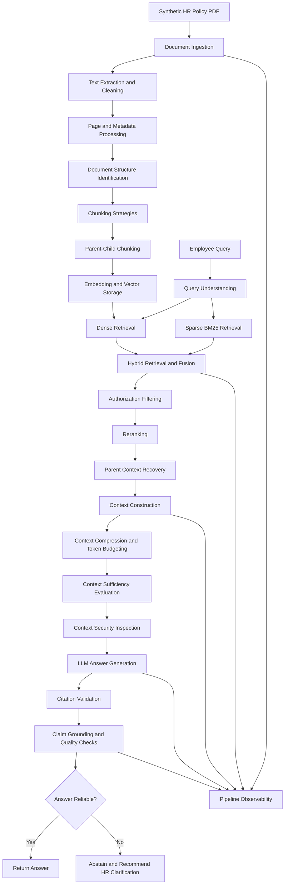

# PH HR Assistant — Context-Engineered HR Policy RAG System

A local, security-aware Retrieval-Augmented Generation (RAG) prototype for answering employee questions using a synthetic Human Resources policy manual.

The project explores how Context Engineering techniques can improve document ingestion, retrieval quality, context construction, access control, answer grounding, abstention, and pipeline observability.

> **Project status:** Working engineering prototype. Core components and automated tests are implemented. The project is not yet a production-ready, multi-user HR application.

---

## 1. Problem Statement

Employees often need reliable answers to questions about company policies, leave, performance appraisals, workplace procedures, and other HR-related matters.

A basic RAG system can retrieve relevant text and pass it to an LLM. However, retrieving text alone does not guarantee a correct answer.

This project investigates the broader engineering challenges:

- Extracting and preserving document structure.
- Creating meaningful chunks from long policy documents.
- Retrieving relevant evidence through dense and sparse search.
- Combining and reranking retrieved results.
- Recovering parent context when smaller child chunks are retrieved.
- Controlling the context supplied to the LLM.
- Restricting access to documents according to user roles.
- Detecting known prompt-injection patterns in retrieved context.
- Validating citations and claim grounding.
- Abstaining when evidence is insufficient.
- Recording execution stages, metrics, and failures.

The objective is to build a RAG system that prioritizes evidence quality and answer reliability over simply generating a response.

## 2. Dataset

The project uses a synthetic HR policy manual created for experimentation and evaluation.

| Attribute             | Dataset details            |
| --------------------- | -------------------------- |
| Document type         | Synthetic HR policy manual |
| Pages                 | 98                         |
| Major sections        | 4                          |
| Policies              | 14                         |
| Subsections           | 110                        |
| Empty extracted pages | 0                          |
| Original format       | PDF                        |

The document contains policy-like information suitable for testing employee HR questions without using confidential company documents.

**Important:** The dataset is synthetic. Its policy contents should not be treated as real legal, employment, or organizational guidance.

## 3. System Architecture

The overall architecture combines document processing, retrieval, context engineering, generation, quality controls, and observability.



The diagram represents the broader project architecture. Not every experimental component is necessarily executed by the active generation pipeline.

## 4. Context Engineering Components

### 4.1 Document ingestion and preprocessing

Implemented capabilities include:

- PDF text extraction using PyPDF.
- Page-level document processing.
- Text normalization and cleaning.
- Preservation of document metadata.
- Handling of hyphenated words across line breaks.
- Removal of unwanted whitespace and soft hyphens.
- Page and document identity validation.

### 4.2 Document structure and metadata

The project includes:

- Table of Contents extraction.
- TOC registry generation.
- Heading identification.
- Section identification.
- Policy structure identification.
- Metadata validation.
- Page and source tracking.

The objective is to preserve the logical structure of the HR manual instead of treating the entire document as unstructured text.

### 4.3 Chunking strategies

Multiple chunking approaches are implemented and explored:

- Fixed-size chunking.
- Recursive chunking.
- Token-aware chunking.
- Parent-child chunking.
- Policy-aware grouping.
- Chunk schema and metadata preservation.

**Verified parent-child experiment results:**

| Experiment                |     Result |
| ------------------------- | ---------: |
| PDF pages extracted       |         98 |
| Pages after TOC exclusion |         94 |
| Parent-child records      |        213 |
| Parent chunks             |         40 |
| Child chunks              |        173 |
| Maximum parent size       | 900 tokens |
| Maximum child size        | 250 tokens |
| Orphan child chunks       |          0 |
| Policy mismatches         |          0 |

A cross-page token-aware experiment using the Performance Appraisal Policy (pages 35–42) produced four chunks across eight pages. The largest chunk contained 445 tokens against a configured maximum of 460.

### 4.4 Query understanding

Implemented modules explore:

- Query classification.
- Query rewriting.
- Query expansion.
- Multi-query generation.

These techniques help improve the search query before retrieval.

### 4.5 Retrieval engineering

The retrieval architecture includes:

- Dense retrieval.
- Sparse BM25 retrieval.
- Hybrid retrieval.
- Rank fusion.
- Metadata filtering.
- Cross-encoder reranking.
- Parent context recovery.
- Retrieval pipeline orchestration.

The objective is to retrieve relevant evidence using complementary retrieval strategies and preserve sufficient surrounding context for answer generation.

**Dense retrieval configuration:**

| Component             | Configuration                    |
| --------------------- | -------------------------------- |
| Embedding model       | `BAAI/bge-small-en-v1.5`         |
| Vector database       | ChromaDB                         |
| Persistence directory | `data/processed/vector_db/dense` |
| Collection            | `hr_policy_dense_children`       |
| Indexed child chunks  | 173                              |

**Verified dense retrieval experiment:**

Query:

`How are internal candidates selected for interview?`

| Rank | Policy                    | Similarity |
| ---: | ------------------------- | ---------: |
|    1 | Recruitment and Selection |     0.8182 |
|    2 | Recruitment and Selection |     0.7404 |
|    3 | Recruitment and Selection |     0.7383 |
|    4 | Recruitment and Selection |     0.7200 |
|    5 | Recruitment and Selection |     0.6924 |

The highest-ranked result directly addresses internal recruitment, including advertising vacancies internally in the first instance.

Similarity scores indicate embedding-space similarity. They do not independently establish factual correctness or retrieval precision.

### 4.6 Context construction and optimization

The context engineering layer includes:

- Context building.
- Context grouping.
- Context ordering.
- Context deduplication.
- Context compression.
- Token budget management.
- Context quality evaluation.
- Context sufficiency evaluation.
- Semantic evidence evaluation.
- Evidence evaluation.

These components help determine what information should reach the generation model and whether the retrieved evidence is sufficient.

### 4.7 Security and authorization

The project explores role-based document access and retrieved-context inspection.

Configured roles include:

| Role     | Intended access                         |
| -------- | --------------------------------------- |
| Employee | Public documents                        |
| Manager  | Public and manager-level documents      |
| HR       | Public, manager, and HR-level documents |
| Admin    | All configured access levels            |

Security-related components include:

- Document access control.
- Policy access configuration.
- Retrieval authorization.
- Context security inspection.

The authorization tests verify that unauthorized documents are excluded from retrieval output and do not reach the reranker.

The context security layer detects configured prompt-injection patterns, such as attempts to override previous instructions or reveal system prompts. The active generation pipeline blocks generation when its context inspection fails.

**Security limitations:** Pattern-based detection cannot identify every indirect, encoded, paraphrased, or split-chunk prompt injection. Role information is not a substitute for authenticated identity. Production deployment would require trusted authentication, server-side authorization, stronger isolation, and additional security testing.

## 5. Generation and Answer Quality

The generation layer uses a local Ollama model.

| Component          | Configuration   |
| ------------------ | --------------- |
| Runtime            | Ollama          |
| Generation model   | `qwen3:8b`      |
| Inference approach | Local inference |

The pipeline explores:

- Evidence-based answer generation.
- Citation validation.
- Citation grounding evaluation.
- Claim grounding validation.
- Generation quality evaluation.
- Abstention control.

The answer quality pipeline is designed to reject answers when required validation conditions are not satisfied.

Examples of abstention conditions include:

- Insufficient context.
- Invalid citations.
- Missing claim-grounding assessments.
- Unsupported or contradicted claims.

An important distinction: a citation being structurally valid does not prove that the cited source semantically supports the answer.

The claim-grounding validator and its tests are implemented. However, the active generation run currently supplies an empty claim-assessment list. Consequently, the quality gate abstains rather than treating citation validity as proof of factual correctness.

This is intentional fail-closed behavior, but completing automated semantic claim assessment remains future work.

## 6. Observability

The project includes a custom `RunObserver` implementation.

It records:

- Pipeline run IDs.
- Stage start and end events.
- Stage durations.
- Execution status.
- Pipeline metrics.
- Failure information.
- Interrupted stages.

The observer supports both successful and failed execution records.

Generated observability records are stored under:

```text
data/processed/observability/
```

These files are generated at runtime and excluded from Git tracking.

## 7. Technology Stack

| Technology             | Purpose                                |
| ---------------------- | -------------------------------------- |
| Python 3.13            | Core implementation                    |
| Ollama                 | Local LLM inference                    |
| Qwen3 8B               | Answer generation                      |
| Sentence Transformers  | Dense embeddings and reranking support |
| BAAI/bge-small-en-v1.5 | Dense embedding model                  |
| ChromaDB               | Vector database                        |
| BM25                   | Sparse retrieval                       |
| PyPDF                  | PDF extraction                         |
| Tokenizers             | Token counting                         |
| Requests               | HTTP communication                     |
| unittest               | Automated testing                      |

**Tokenizer used in chunking and context experiments:**

`mixedbread-ai/mxbai-embed-large-v1`

This tokenizer is used for token counting. It is separate from the BGE embedding model used by the active dense retriever.

The system is designed to run locally rather than depending on a paid hosted LLM API.

## 8. Project Structure

The following is a representative view of the repository. Generated data and some experiment-specific files are intentionally omitted for readability.

```text
ph_hr_assistance/
│
├── data/
│   ├── raw/
│   │   └── hr_policy_manual.pdf
│   │
│   └── processed/                  # Generated; Git-ignored
│       ├── chunks/
│       ├── evaluation/
│       ├── observability/
│       └── vector_db/
│
├── experiments/
│   ├── chunking/
│   ├── context/
│   ├── generation/
│   ├── ingestion/
│   ├── metadata/
│   ├── query_understanding/
│   ├── retrieval/
│   └── security/
│
├── src/
│   └── hr_assistant/
│       ├── chunking/
│       ├── context/
│       ├── generation/
│       ├── ingestion/
│       ├── metadata/
│       ├── observability/
│       ├── query_understanding/
│       ├── retrieval/
│       ├── security/
│       └── config.py
│
├── tests/
│   ├── test_context_security.py
│   ├── test_document_access_control.py
│   ├── test_generation_quality_pipeline.py
│   ├── test_metadata_validator.py
│   ├── test_page_registry.py
│   ├── test_retrieval_authorization.py
│   ├── test_run_observer.py
│   └── test_text_cleaner.py
│
├── build_toc_registry.py
├── main.py
├── requirements.txt
├── .gitignore
└── README.md
```

The `experiments/` directory contains focused implementations and experiments. These should not be interpreted as a single automatically executed pipeline.

Generated files under `data/processed/` are recreated locally and are not committed to Git.

## 9. Setup and Installation

### Prerequisites

- Python 3.13.
- Git.
- Ollama.
- A local machine capable of running the selected embedding and generation models.

### Step 1: Clone the repository

```powershell
git clone https://github.com/sairamsenthil/ph_hr_assistance.git

cd ph_hr_assistance
```

### Step 2: Create a virtual environment

```powershell
python -m venv .venv

.venv\Scripts\Activate.ps1
```

If PowerShell blocks script execution, use the following command in the current terminal:

```powershell
Set-ExecutionPolicy -Scope Process -ExecutionPolicy RemoteSigned
```

Then activate the environment again.

### Step 3: Install dependencies

```powershell
python -m pip install --upgrade pip

python -m pip install -r requirements.txt
```

### Step 4: Configure Ollama

Ensure Ollama is installed and running.

Pull the generation model:

```powershell
ollama pull qwen3:8b
```

The dense embedding model, `BAAI/bge-small-en-v1.5`, is loaded through Sentence Transformers and may be downloaded automatically during the first indexing run.

The Mixedbread tokenizer may also require a first-run model download.

These model downloads use the respective model repositories. No Hugging Face authentication token was required for the verified indexing run.

## 10. Rebuilding the Data and Retrieval Artifacts

The repository tracks the original synthetic PDF, but generated chunks and vector databases are excluded from Git.

After cloning the repository, recreate the ingestion and chunking artifacts in the following order.

Run these commands from the project root.

### Step 1: Extract PDF pages

```powershell
python -m src.hr_assistant.ingestion.document_processor
```

Expected output:

```text
Saved 98 documents to:
data/processed/hr_policy_pages.jsonl
```

### Step 2: Build the Table of Contents registry

```powershell
python build_toc_registry.py
```

Verified extraction results:

- 128 TOC entries.
- 4 major sections.
- 14 main policies.
- 110 subsections.
- 0 unclassified entries.

**Source document note:** Policy 6, Controlling Absence Policy, has a missing subsection number `[3]` in the source TOC. This is a source-document numbering gap, not a correction made by the pipeline.

### Step 3: Prepare policy pages

```powershell
python -m experiments.chunking.recursive.prepare_policy_pages
```

This step excludes the four TOC pages and prepares the remaining policy pages.

Verified result: 94 pages.

### Step 4: Normalize policy pages

```powershell
python -m experiments.chunking.recursive.normalize_policy_pages
```

Verified result:

- 94 pages processed.
- 4 pages affected.
- 8 dotted runs replaced.
- 1 dashed run removed.

### Step 5: Generate parent-child chunks

```powershell
python -m experiments.chunking.parent_child.test_parent_child
```

Verified result:

- 40 parent chunks.
- 173 child chunks.
- 213 total records.
- Zero orphan children.
- Zero policy mismatches.
- All six validation checks passed.

### Step 6: Build the dense vector index and test retrieval

```powershell
python -m experiments.retrieval.dense.test_dense_retrieval
```

This step loads the child chunks, generates embeddings, stores them in ChromaDB, and executes a sample retrieval query.

Verified result:

- 173 child chunks processed.
- 173 vectors stored.
- Five dense retrieval results returned.

**Reproducibility status:** The ingestion-to-dense-retrieval sequence above has been successfully executed using regenerated processed data in the development environment. A complete fresh-clone generation run has not yet been verified.

## 11. Running the Generation Pipeline

The active generation pipeline is located at:

```text
src/hr_assistant/generation/test_llm_answer_generation.py
```

Its module invocation is:

```powershell
python -m src.hr_assistant.generation.test_llm_answer_generation
```

**Execution prerequisites:**

- Ollama must be running.
- The `qwen3:8b` model must be available locally.
- Parent-child chunk data must exist.
- The dense vector database must be prepared.
- Any other artifacts required by the active retrieval and context pipeline must be available.

The generated artifacts are stored under `data/processed/` and are not committed to Git.

Local 8B model inference can take several minutes, depending on hardware. This command is not a lightweight unit test.

## 12. Running Automated Tests

The project uses Python's built-in `unittest` framework.

Run the complete test suite:

```powershell
python -m unittest discover -s tests -v
```

Run tests without verbose output:

```powershell
python -m unittest discover -s tests -q
```

Compile-check the source and test files:

```powershell
python -m compileall -q src tests experiments
```

Check installed dependency consistency:

```powershell
python -m pip check
```

### Verified test results

Latest verified unit-test run:

| Check                  | Result            |
| ---------------------- | ----------------- |
| Automated unit tests   | 71 passed         |
| Test execution time    | 0.083 seconds     |
| Dependency consistency | Previously passed |
| Python compilation     | Previously passed |

Test coverage includes:

- Context security.
- Document access control.
- Retrieval authorization.
- Citation validation.
- Claim grounding validation.
- Abstention behavior.
- Generation quality pipeline.
- Metadata validation.
- Run observability.
- Text cleaning.

These are unit-test results, not a claim of complete end-to-end production validation.

## 13. Example Pipeline Execution

One successful local generation-pipeline execution was recorded with the following results:

| Stage              |       Duration |
| ------------------ | -------------: |
| Retrieval          |   0.75 seconds |
| Context building   |   0.08 seconds |
| Context security   |  0.003 seconds |
| Generation         | 597.94 seconds |
| Quality evaluation | 0.0002 seconds |
| Total              | 604.45 seconds |

Additional recorded metrics:

- Retrieved sources: 3.
- Context tokens: 2,655.
- Configured context budget: 3,000 tokens.
- Context security: passed.
- Citation validation: passed.
- Final decision: abstain.

The final decision was abstention because the active run did not provide claim-grounding assessments.

Generation time is hardware-dependent. The recorded run used a local Qwen3 8B model on a CPU-based development setup and should not be treated as a general performance benchmark.

## 14. Current Limitations

This project is an engineering prototype, not a production HR application.

Known limitations include:

1. **Authentication:** Role-based access logic exists, but trusted production identity and authentication are not implemented.
2. **Authorization enforcement:** Production-grade database-level access filtering and isolation still need to be established.
3. **Prompt-injection detection:** Current context inspection is pattern-based and cannot guarantee detection of all attacks.
4. **Semantic claim assessment:** The active generation workflow does not yet automatically assess every generated claim.
5. **Performance:** Local 8B model inference can be slow on CPU-only hardware.
6. **Pipeline reproducibility:** The ingestion, chunking, and dense indexing sequence has been verified, but the complete fresh-clone generation workflow still needs end-to-end verification.
7. **Application interface:** A production web interface, employee-facing API, and deployment workflow are outside the current implementation.

## 15. Future Improvements

Potential next engineering milestones:

- Complete an automated fresh-clone ingestion-to-generation workflow.
- Integrate semantic claim-grounding assessment into the active generation pipeline.
- Improve retrieval and generation evaluation using a structured question-answer benchmark.
- Add stronger indirect prompt-injection defenses.
- Integrate trusted authentication and server-side authorization.
- Evaluate retrieval quality using Precision@K, Recall@K, MRR, and related metrics.
- Add repeatable end-to-end regression tests.
- Optimize local inference performance.
- Build an employee-facing application interface.

## 16. Engineering Objective

This project is part of a broader effort to develop practical expertise in Agentic AI and Context Engineering.

Its central engineering principle is:

> A reliable RAG system must do more than retrieve relevant documents and generate text. It must manage evidence, context, access, uncertainty, validation, and execution observability throughout the pipeline.

---

**Repository:** https://github.com/sairamsenthil/ph_hr_assistance

**Project:** PH HR Assistance

**Focus:** Context Engineering, RAG Architecture, Retrieval Engineering, Security, Grounded Generation, and Observability.
